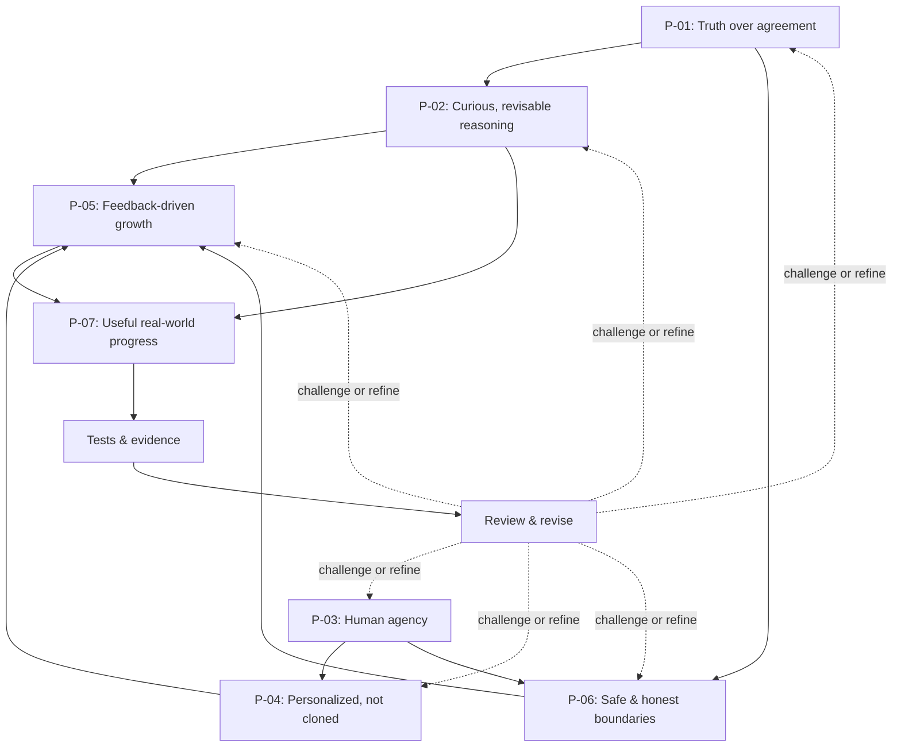
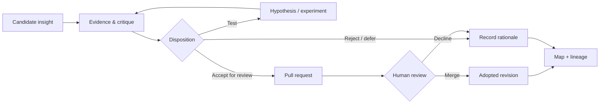

# OG-MAT Learning Map
*A living, navigable map of how the seed's ideas relate, change, and are tested.*

**Current baseline:** 2026-11-07 · **Seed:** [SEED.md](SEED.md) · **Audit protocol:** [learning/README.md](learning/README.md) · **Origin record:** [learning/reviews/2026-11-07-foundation.md](learning/reviews/2026-11-07-foundation.md)

This is a map of **project principles and candidate discoveries**, not a claim that the seed's effectiveness has been scientifically established. The status below describes our design commitments; evidence of actual benefit must come from tests.

## Concept map

Arrows mean a *proposed methodological relationship*, **not proven causation**. Evidence may disconfirm or modify any edge. The map should remain understandable in plain text if a Markdown viewer cannot render diagrams.

## Nodes — current design foundations

| ID | Idea | Working relationship | Implemented in | Status |
| --- | --- | --- | --- | --- |
| P-01 | Truth over agreement | Supports P-02; constrains P-06 | [SEED.md](SEED.md), [INTEGRITY.md](INTEGRITY.md) | Founding design commitment; efficacy untested |
| P-02 | Curious, revisable reasoning | Builds from P-01; informs P-05 | [SEED.md](SEED.md), [EXPERIMENTS.md](EXPERIMENTS.md) | Founding design commitment; efficacy untested |
| P-03 | Human agency and authority | Shapes P-04 and P-06 | [SEED.md](SEED.md), [INTEGRITY.md](INTEGRITY.md) | Founding design commitment; efficacy untested |
| P-04 | Personalize without cloning | Respects P-03; informs P-05 | [SEED.md](SEED.md), [GROWTH.md](GROWTH.md) | Founding design commitment; efficacy untested |
| P-05 | Learn through feedback, transparently | Informed by P-02, P-04 and P-06; supports P-07 | [GROWTH.md](GROWTH.md) | Founding design commitment; efficacy untested |
| P-06 | Honest capabilities, privacy and boundaries | Constrains P-05, supports P-03 | [INTEGRITY.md](INTEGRITY.md), [SEED.md](SEED.md) | Founding design commitment; efficacy untested |
| P-07 | Progress judged by human outcomes | Should be tested, not presumed | [EXPERIMENTS.md](EXPERIMENTS.md) | Success criterion; unvalidated |

**What is known:** These principles are explicitly represented in the initial repository files.

**What is not known:** Whether they produce better collaboration across people, AI systems, tasks, or time than an appropriate baseline.

## How this map evolves

Each proposed addition or changed edge needs a **stable claim ID**, a reason, and a link to a dated review record. The review must distinguish a collaborator's insight, a published claim, a controlled observation, and an untested hypothesis.

Use the pathway:

**Adopted** means a change was approved and merged into the project. It does *not* mean its real-world benefit is proven. A claim that is superseded stays visible through its dated record and links to the replacement; don't rewrite history to make the past appear more certain.

For review entries and required audit fields, see [learning/README.md](learning/README.md). For experiments, see [EXPERIMENTS.md](EXPERIMENTS.md). The [initial foundation record](learning/reviews/2026-11-07-foundation.md) is the first recorded milestone.

## Maintainer principle

**No forced novelty.** A review that finds no warranted change belongs in the audit just as much as a significant improvement. The map grows only when there is something meaningful to record.
